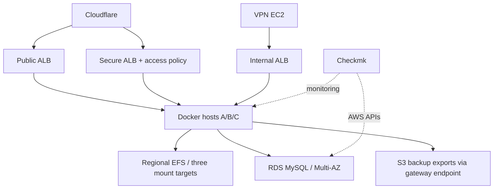

# StratHost — AWS Terraform Master Plan

**Status:** Proposed engineering baseline for interview assignment; implementation and validation pending.  
**Scope:** Infrastructure as Code, optional sandbox deployment, technical documentation and interview demonstration.  
**Region:** eu-west-1 (Ireland), configurable.  
**Source:** Supplied StratHost/Cloudflare architecture diagram and agreed planning discussion.

## 1. Objectives and acceptance boundaries

Build a reproducible, secure, modular Terraform implementation of the supplied three-AZ WordPress hosting infrastructure. The interview requires Terraform, not a live deployment. A temporary AWS deployment is optional and requires explicit approval of account, scope and estimated cost. Never claim that application services are operational merely because infrastructure exists.

Deliver source code, provider lockfile, environment examples, architecture decisions, deployment and destruction runbooks, automated tests, and evidence of checks actually executed. No secrets, state, saved plans or private keys may enter Git.

## 2. Architecture baseline

- One VPC, 10.0.0.0/16, nine /24 subnets across three AZs.
- One VPC-attached internet gateway; one NAT gateway in diagram-faithful/test configuration, three zonal NAT gateways in production.
- Three EC2 Docker hosts, one EC2 VPN host, one EC2 Checkmk host.
- Two internet-facing ALBs (public and secure), one internal ALB, each spanning all three appropriate subnets.
- One Regional EFS filesystem, three mount targets; one RDS MySQL Multi-AZ DB instance deployment (primary and non-readable standby); one regional S3 workload backup bucket.
- Cloudflare DNS, proxy and access controls, optional until domain/zone credentials are available.

### Architecture decisions and diagram differences

| Diagram element | Implementation decision |
|---|---|
| IGW drawn in AZ B | IGW belongs to VPC, not AZ |
| NAT drawn outside subnet in AZ C | Place in public C for single-NAT profile; per-AZ public subnet for production |
| ALBs shown in individual AZs | Each ALB spans at least two AZs; use three |
| Three EFS symbols | One Regional EFS, one mount target per app subnet |
| S3 in AZ A | Regional service, not inside subnet |
| Primary/standby fixed AZs | RDS controls placement and failover; use DNS endpoint |
| Checkmk in public C | No public IP; see outbound connectivity decision below |
| Secure ALB | Proposed restricted websites protected by real authentication; HTTPS alone is insufficient |



ALBs independently target Docker hosts; no unsupported ALB-to-ALB chaining is assumed. Separate target groups and host/path routing must prevent secure workloads from being accessible via the public listener.

## 3. Naming and tagging

Use lowercase hyphen-separated names: `project-environment-region-resource-purpose-index`. Generate names using Terraform locals. Region abbreviation `euw1`; project `strathost`; environments `dev`, `test`, `prod`. Validate input lengths and resource-specific restrictions; ALB/target group names maximum 32 characters, S3 names globally unique and maximum 63 characters. Use deterministic shortening with hash if required. Never truncate into collisions.

| Resource | Production example |
|---|---|
| VPC | strathost-prod-euw1-vpc |
| IGW | strathost-prod-euw1-igw |
| NAT / EIP | strathost-prod-euw1-nat-a / strathost-prod-euw1-eip-nat-a |
| Subnets | strathost-prod-euw1-snet-public-a / snet-app-a / snet-db-a (full prefix) |
| Route tables | strathost-prod-euw1-rt-public / rt-app-a / rt-db (full prefix) |
| EC2 | strathost-prod-euw1-ec2-docker-01 through 03 |
| VPN | strathost-prod-euw1-ec2-vpn-01 |
| Checkmk | strathost-prod-euw1-ec2-checkmk-01 |
| ALBs | strathost-prod-euw1-alb-public / alb-secure / alb-internal (full prefix) |
| Target groups | strathost-prod-euw1-tg-public / tg-secure / tg-internal (full prefix) |
| Security groups | strathost-prod-euw1-sg-{role} |
| RDS | strathost-prod-euw1-rds-mysql |
| EFS | strathost-prod-euw1-efs-wordpress |
| Backup bucket | strathost-prod-euw1-backup-{account_id} |
| State bucket | strathost-tfstate-{account_id}-euw1 |
| KMS aliases | alias/strathost/prod/{purpose} |
| IAM roles | strathost-prod-euw1-role-{purpose} |

Apply provider default tags wherever supported; explicitly tag resources not covered by provider defaults (including relevant volumes). Resource-specific tags override defaults as needed.

| Tag | Value / rule |
|---|---|
| Name | Generated resource name |
| Project | StratHost |
| Application | WordPressHosting |
| Environment | dev/test/prod |
| ManagedBy | Terraform |
| Owner | Infrastructure (proposed team label) |
| BusinessUnit | StratHost |
| CostCenter | Configurable; do not invent company codes |
| DataClassification | Resource-specific |
| Criticality | Environment/resource-specific |
| BackupPolicy | Resource-specific |
| Repository | strathost-infrastructure |

## 4. Network and IPAM

VPC DNS support and DNS hostnames enabled. AZ labels are account-relative; resolve available AZs and document mapping. Each /24 has 251 AWS-usable addresses. AWS reserves first four and last address.

| AZ | Public | Private application | Isolated database |
|---|---|---|---|
| eu-west-1a | 10.0.1.0/24 | 10.0.4.0/24 | 10.0.7.0/24 |
| eu-west-1b | 10.0.2.0/24 | 10.0.5.0/24 | 10.0.8.0/24 |
| eu-west-1c | 10.0.3.0/24 | 10.0.6.0/24 | 10.0.9.0/24 |

| Host | Proposed private IP | Public IP |
|---|---|---|
| VPN01 | 10.0.1.10 | Elastic IP |
| Checkmk01 | 10.0.3.10 | None |
| Docker01 | 10.0.4.10 | None |
| Docker02 | 10.0.5.10 | None |
| Docker03 | 10.0.6.10 | None |
| EFS A/B/C | 10.0.4.20 / 10.0.5.20 / 10.0.6.20 | None |
| RDS, ALB | AWS allocated; use DNS | Scheme dependent |

Disable automatic public IP assignment in every subnet; explicitly associate EIP with VPN. Fixed EC2 addresses are for assignment fidelity; future ASG implementation uses dynamic addresses. Validate CIDR containment, uniqueness, AZ count, static address conflicts and VPN overlap.

### Routing

| Route table | Destination | Target |
|---|---|---|
| All | 10.0.0.0/16 | Local (implicit) |
| Public | 0.0.0.0/0 | IGW |
| App A/B/C | 0.0.0.0/0 | Same-AZ NAT in prod, NAT C in single-NAT test |
| App A/B/C | S3 managed prefix list | S3 gateway endpoint |
| Database | No default route | Isolated |

Associate all nine subnets explicitly. Keep default NACLs initially, enforce stateful security groups; if custom NACLs required, account for return ephemeral ports. S3 endpoint policy must permit only necessary buckets/operations, including any AWS-managed buckets needed for bootstrap/SSM. Enable VPC Flow Logs with retention and scoped IAM.

**Checkmk outbound decision:** An EC2 instance without a public IP in a public subnet cannot use the IGW for internet access. Preferred functional implementation: place Checkmk in private app C at 10.0.6.30, document departure from diagram, route via NAT. Diagram-faithful option: keep 10.0.3.10 with prebuilt image and required private endpoints, and explicitly account for package updates and AWS API access. Do not claim both configurations simultaneously. Default to functional private placement unless interview rubric mandates exact placement.

## 5. Compute sizing and OS

Sizing is an initial assumption, not benchmarked capacity. Use Ubuntu Server 24.04 LTS x86_64, Canonical trusted AMI owner, verify image availability and pin tested AMI IDs per release. T3 burstable instances may require M-series for sustained production CPU. GP3 encrypted EBS, IMDSv2 required, no SSH ingress, SSM agent verified, time sync and patching configured.

| Role | Prod type / vCPU / RAM / root GiB | Test type / root GiB |
|---|---|---|
| Docker01–03 | t3.large / 2 / 8 GiB / 50 | t3.small / 20 |
| VPN01 | t3.small / 2 / 2 GiB / 20 | t3.micro / 15 |
| Checkmk01 | t3.medium / 2 / 4 GiB / 50 | t3.medium / 30 |

Role-specific instance profiles, encrypted root volumes, explicit CPU credit mode, CloudWatch logs, controlled unattended security updates. Use Docker Engine and Compose with pinned versions; install from trusted repositories, verify package signatures, no exposed Docker socket. Prefer versioned bootstrap scripts or prebuilt AMI; user data must be idempotent and contain no secrets. Verify cloud-init completion and logs. Separate infrastructure provisioning from application configuration.

WordPress: immutable container images, persistent uploads on EFS, coordinated plugin/theme releases, shared database, per-site credentials, health endpoint `/healthz` on proposed backend TCP 8080. Prevent container startup if EFS is not mounted. Do not make a generic healthy endpoint substitute for actual application readiness. No assumption of automatic scaling or zero-downtime upgrades for fixed hosts.

## 6. Load balancing and TLS

| Property | Public | Secure | Internal |
|---|---|---|---|
| Scheme | Internet-facing | Internet-facing | Internal |
| Subnets | Public A/B/C | Public A/B/C | App A/B/C |
| Listener | HTTPS 443 | HTTPS 443 | HTTPS 443 |
| Access | Cloudflare proxy | Cloudflare + access policy | Approved private/VPN clients |
| Target group | Independent | Independent | Independent |
| Target | Docker hosts | Docker hosts | Docker hosts |
| Backend port | 8080 proposed | 8080 proposed | 8080 proposed |
| Health check | /healthz | /healthz | /healthz |

Use ACM certificates with validated DNS; internal names need trusted certificates appropriate to private DNS. Require modern TLS policy. Optional HTTP redirect only if justified. For production Cloudflare Full (strict) TLS, restrict origin ingress to maintained Cloudflare IPv4/IPv6 ranges as applicable; origin restrictions alone do not prove requests belong to your zone. Use suitable authenticated origin controls and secure ALB authentication or independently enforced application authorization. Public listener must reject protected routes. Enable access logs to a dedicated compatible S3 log bucket (verify ALB log delivery encryption and policy requirements). Enable deletion protection in production, disabled in test. If no domain/certificate is available, allow explicit isolated test-only HTTP from approved CIDRs; never silently downgrade production TLS.

## 7. RDS MySQL

| Setting | Production | Temporary test |
|---|---|---|
| Engine | MySQL 8.4 LTS, supported minor pinned | Same |
| Class | db.t4g.medium (2 vCPU, 4 GiB) | db.t4g.micro (verify availability) |
| Multi-AZ | True | False |
| GP3 storage | 100 GiB, max 500 | 20 GiB, max 100 |
| Backup retention | 14 days | 1 day |
| Public access | False | False |
| Encryption | KMS | KMS |
| Deletion protection | True | False |
| Final snapshot | Required | Explicit opt-out for disposable data |

Verify engine/class/storage compatibility in eu-west-1 before plan. DB subnet group includes three isolated subnets. Require TLS using engine parameter configuration, restrict port 3306 to application SG. Use RDS-managed master secret in Secrets Manager, never plaintext Terraform passwords. Create restricted per-site database users through a separate secure bootstrap workflow; application IAM role only reads its own secret. Define maintenance windows, backup windows, monitoring and alarms. Standby is not a read replica. Test DNS-based reconnect and failover only with approval.

## 8. EFS, backup and encryption

Regional EFS, general purpose, Elastic throughput, KMS encryption at rest, TLS mounts, three mount targets in app subnets; `/srv/wordpress/shared` proposed. Per-tenant access points with POSIX permissions; IAM-authorized mounts and filesystem policy requiring TLS. Verify EFS client compatibility on Ubuntu. Mount through amazon-efs-utils and ensure startup ordering. NFS TCP 2049 from Docker SG only.

Workload backup bucket separate from state and log buckets. Block public access, enforce TLS, bucket owner enforced, versioning, SSE-KMS for sensitive exports, scoped IAM, lifecycle and noncurrent-version expiration. Avoid destructive force_destroy in production. Separate optional cross-region/account recovery copies from base design. Native RDS snapshots and AWS Backup recovery points are not automatically S3 files.

| Backup | Schedule / retention proposal |
|---|---|
| RDS native | Daily + PITR, 14 days |
| EFS AWS Backup | Daily, 30 days |
| EBS AWS Backup | Daily, 14 days |
| Application exports to S3 | Daily, 30 days |
| Monthly recovery points | 12 months, if configured |
| Terraform state | Versioning, controlled lifecycle |

Use AWS Backup plans, vaults, scoped role and selection tags; avoid accidental duplicate EFS backup plans. Application export jobs require separate implementation. Define RPO/RTO with business owner; no guarantee until restore tests. Verify restore into isolated environment and document evidence.

## 9. Security and access matrix

| Source | Destination | Protocol |
|---|---|---|
| Cloudflare ranges | Public/secure ALB SG | TCP 443 |
| Approved client CIDRs | VPN SG | UDP 51820 |
| Approved private/VPN sources | Internal ALB SG | TCP 443 |
| Each ALB SG | Docker SG | TCP 8080 |
| Docker SG | RDS SG | TCP 3306 |
| Docker SG | EFS SG | TCP 2049 |
| Checkmk SG | Docker/managed host SGs | TCP 6556, secured agent mode |
| EC2 roles | SSM, logs, secrets, approved updates | TCP 443 via NAT/endpoints |

Default-deny inbound. Explicit outbound rules appropriate to role; security groups cannot filter arbitrary destination FQDNs. Document HTTPS egress via NAT when required, tighten via interface endpoints/prefix lists or proxy where feasible. Do not expose SSH, MySQL, NFS, Checkmk UI or Docker API publicly. Use SSM Session Manager with audit logs and scoped operator permissions. Validate required regional SSM endpoints and agent connectivity. Separate IAM roles for Docker, VPN, Checkmk, backup, flow logs and deployment; no broad admin policy for workloads. Scope secrets/KMS permissions and resource ARNs. Avoid circular SG dependencies using standalone ingress/egress rule resources.

CloudTrail and GuardDuty are account-level integrations; avoid duplicating existing organization controls. AWS Config optional. Production alerting for instance health, ALB unhealthy targets/5xx, RDS storage and CPU, backup failures, NAT errors and budget thresholds. SNS destination requires owner-provided contact. No sensitive payloads in logs.

## 10. VPN and Checkmk

WireGuard proposed, UDP 51820, VPN network 10.250.0.0/24 subject to overlap checks. Per-peer keys generated and distributed securely outside Terraform. Split tunnel; restrict routes and forwarding to approved internal services. Disable source/destination check if routing. Choose routed mode (return routes to VPN ENI and CIDR-based SGs) or controlled SNAT (target rules reflect translated source); document choice. No forwarding to isolated DB unless separately approved. Test peer connectivity and revocation. VPN is a single-instance dependency in supplied design; managed Client VPN or redundant appliances are future options.

Checkmk edition/version/licence to be confirmed; use supported Ubuntu package or tested image. Monitor EC2, Docker, WordPress, ALB target health, RDS, EFS, VPN, backups, TLS and AWS API metrics. Use least-privilege monitoring role and encrypted agent communications; restrict UI to SSM port forwarding or authorized private access. Install agents and register hosts through separate configuration workflow. Verify real checks before claiming coverage.

## 11. Terraform repository design

```text
strathost-infrastructure/
  README.md
  .gitignore
  .terraform-version
  .tflint.hcl
  bootstrap/
  modules/
    networking/
    security-groups/
    iam/
    kms/
    compute/
    load-balancing/
    database/
    efs/
    s3/
    backup/
    monitoring/
    cloudflare/
    platform/            # shared composition for environment roots
  environments/
    dev/
    test/
    prod/
  scripts/
    validate.ps1
    deploy.ps1
    smoke-test.ps1
    destroy.ps1
  docs/
    MASTER-PLAN.md
    architecture-decisions.md
    deployment-runbook.md
    cost-estimate.md
    validation-evidence.md
  .github/workflows/terraform-ci.yml
```

Each module: main.tf, variables.tf, outputs.tf, versions.tf, README.md; split complex resources into logical files. Root environments: main.tf, providers.tf, versions.tf, variables.tf, locals.tf, outputs.tf, backend.tf, terraform.tfvars.example, backend.hcl.example, tests/*.tftest.hcl. Keep module provider configurations in roots. Prefer typed variables, validation, stable for_each keys, clear descriptions, minimal useful outputs, no secret outputs. Use shared composition module to avoid environment drift. Commit provider lockfiles for root configurations; pin tested Terraform and provider versions after checking current official registry. S3 native lockfile requires Terraform 1.10 or later. Do not use unbounded latest versions or deprecated DynamoDB locking for new deployments.

### Configuration inputs

Project, environment, region, AZs, VPC CIDR/subnet map, NAT strategy, compute sizes/AMI IDs/volume sizes, RDS engine/version/class/storage/Multi-AZ, backup retention, deletion protection, feature flags, approved CIDRs, domain/zone/certificate identifiers, tags, log retention, budget thresholds. Use validated defaults and examples; real account-specific values supplied through environment configuration, never fabricated.

### State and Git hygiene

Separate bootstrap state from workload state. State bucket encrypted, versioned, block public access, TLS-only, native lockfile, scoped permissions for state object and lock object. Distinct environment keys and preferably distinct AWS accounts for production/test. Bootstrap locally, securely preserve bootstrap state, then migrate if appropriate. Avoid state backend circular dependency. Keep backend config partial, credentials supplied through AWS profile/SSO. Exclude `.terraform/`, `*.tfstate*`, `*.tfplan`, crash logs, real sensitive tfvars, private keys and local env files; include `.terraform.lock.hcl` and sanitized examples. Saved plans may contain secrets. CI must not expose plan JSON or credentials in logs. Use OIDC short-lived credentials for approved AWS CI jobs; no automatic apply on PRs.

## 12. Environment profiles

| Setting | Production | Test |
|---|---|---|
| AZs/subnets | 3 / 9 | 3 / 9 |
| EC2 | 5 | 5 |
| NAT | 3 zonal | 1 in C |
| ALBs | 3 | 3 |
| RDS | Multi-AZ | Single-AZ |
| EFS mount targets | 3 | 3 |
| Deletion protection | Enabled | Disabled |
| Backups | Full policy | Minimal/disposable |
| Cloudflare | Configured once credentials and DNS approved | Optional |

Minimal smoke profile may disable costly services but cannot prove full architecture or HA. For an interview full-fidelity live test, enable Multi-AZ and all required integrations explicitly; distinguish from reduced-cost profile. Never use real customer data.

## 13. Implementation workflow

1. Create private Git repository, add this master plan and original diagram if authorized. Establish baseline commit and branch protection.
2. Verify current official Terraform/AWS/Cloudflare/Canonical/Checkmk documentation; record versions and decisions.
3. Build bootstrap and project composition, naming/tagging, validation rules.
4. Build networking, route associations, NAT strategy, endpoints, flow logs.
5. Build KMS, IAM, security groups, logging.
6. Build S3, EFS, RDS, backup plans.
7. Build compute, instance profiles, cloud-init templates and application bootstrap boundaries.
8. Build ALBs, target groups, listeners, certificates and conditional Cloudflare integration.
9. Build monitoring, VPN configuration interfaces and CI checks.
10. Run format, validate, lint, security scan, mocked tests; fix and retest.
11. Review actual AWS plan, optional approved deployment, smoke checks, teardown.
12. Document evidence, remaining limitations and interview talking points.

Use small logical commits and review diffs. Do not change CIDRs, architecture or naming silently. Record deviations in ADRs.

## 14. Workstation and validation commands (Windows PowerShell)

Install Terraform, AWS CLI v2, Git, VS Code Terraform extension, PowerShell 7, TFLint and Trivy from trusted sources. Verify versions. From repository root run formatting check; from each independently initialized root run validation and tests. Example for test root:

```powershell
terraform fmt -check -recursive
Set-Location environments/test
terraform init -backend=false
terraform validate
tflint --init
tflint
trivy config ../../
terraform test
```

Mocked tests must explicitly mock providers and avoid real apply. Assert CIDRs, AZ count, routing, SG rules, encryption, no public DB, IMDSv2, NAT counts, target group associations, backup settings and production protections. Run each root and bootstrap validation; inspect scripts and cloud-init separately. Static checks cannot prove cloud permissions, quotas, actual runtime behavior or external integrations.

## 15. Optional AWS deployment runbook

**Approval gate:** Confirm sandbox AWS account ID, region, temporary credential profile, domain scope, cost ceiling and teardown owner before any billable create. Budget alerts are not hard spending caps. Check service quotas, instance/engine availability and existing resources. Configure IAM Identity Center or approved temporary credentials.

```powershell
aws sso login --profile strathost-test
$env:AWS_PROFILE = 'strathost-test'
aws sts get-caller-identity
aws ec2 describe-availability-zones --region eu-west-1
```

Bootstrap from `bootstrap/`: initialize, validate, create saved plan, inspect and approve before apply. Securely record state bucket and backend parameters. From `environments/test/`, prepare real test.tfvars and backend.hcl from examples; do not commit secrets. If existing local state exists, review migration rather than blindly reconfigure.

```powershell
terraform init -reconfigure -backend-config=backend.hcl
terraform plan -var-file=test.tfvars -out=test.tfplan
terraform show test.tfplan
# Only after explicit approval of the reviewed plan:
terraform apply test.tfplan
```

Review replacements/destructions, all CIDRs, public exposure, encryption, expected resources, provider account/region and cost. On failure inspect state and AWS resources; do not blindly rerun or delete state. Use refresh/plan and resolve root cause. Do not manually alter resources without documenting drift and reconciling Terraform.

### Smoke tests and evidence

| Test | Success evidence |
|---|---|
| Networking | Nine subnets, correct associations, app NAT egress, no DB default route |
| EC2 | Five expected instances, SSM online, cloud-init successful, encrypted volumes, IMDSv2 |
| Docker | Pinned runtime, containers healthy, no public port exposure |
| EFS | Three mount targets available; TLS mount and controlled cross-node file test |
| RDS | Private endpoint, TLS connectivity from app, restricted account, no public access |
| ALBs | Correct listeners, certificate, healthy targets, public/secure separation |
| VPN | Authorized peer connects only to approved services; unauthorized peer denied |
| Checkmk | Real monitored hosts/checks report expected status |
| Cloudflare | DNS/proxy/TLS and access control verified, direct origin bypass denied |
| Backup | Backup job/recovery point or controlled export; restore test where practical |

Record command, date, result, evidence and limitations. Redact account identifiers, secrets and sensitive endpoints as appropriate for interview sharing. If a component is not configured, record NOT TESTED, not PASS.

### Teardown

```powershell
terraform plan -destroy -var-file=test.tfvars -out=destroy.tfplan
terraform show destroy.tfplan
# After reviewing disposable scope and approving destruction:
terraform apply destroy.tfplan
```

Remove optional Cloudflare test records safely, verify EC2/EBS, NAT/EIPs, ALBs, RDS and snapshots, EFS, backup recovery points, log groups, S3 versions, endpoints and KMS keys scheduled for deletion where appropriate. Retained resources may still incur charges. Empty disposable versioned buckets only after scope review. Keep bootstrap/state bucket until workload removal verified; tear down separately only if requested. Never destroy shared or production resources. Check billing after usage reporting catches up.

## 16. Cost planning

Prior illustrative planning allowances (NOT verified regional rates): test approximately USD 0.40/hour; production approximately USD 0.85/hour. Six hours approximately USD 2.40 / USD 5.10 respectively; 730-hour equivalents USD 292 / USD 620.50. These are rough allowances, not a quote or cap. Actual pricing may differ materially. Include EC2 hours and EBS, NAT hours and bytes, ALB hours and LCU usage, public IPv4, RDS compute/storage/backups, EFS throughput/storage, S3 requests/storage, endpoints, CloudWatch, KMS, Secrets Manager, AWS Backup, transfer, Cloudflare licence and taxes. Minimum billing increments and retained resources may affect short tests. Use AWS Pricing Calculator and region-specific current rates before approval. Do not assume Free Tier coverage.

## 17. CI and acceptance gates

- [ ] Terraform/provider versions pinned and root lockfiles committed.
- [ ] Formatting, init, validate, TFLint and Trivy run; findings resolved or justified.
- [ ] Mocked tests pass for all profiles and negative cases.
- [ ] Network CIDRs/routes/AZs verified against diagram.
- [ ] Security groups, IAM, encryption, secrets and state controls reviewed.
- [ ] No credentials/state/plans in Git; secret scan performed.
- [ ] README, module docs, ADRs, runbook and examples reviewed.
- [ ] AWS plan reviewed if credentials available; no unexpected changes.
- [ ] Live smoke checks executed if approved; untested items documented.
- [ ] Temporary resources destroyed and residual billing sources checked if deployed.

## 18. Interview talking points

Explain VPC/subnet isolation; AZ resilience; single versus per-AZ NAT tradeoff; independent public/secure/internal ALBs; EFS versus EBS; RDS Multi-AZ versus read replicas; static IPs versus ASGs; SSM versus SSH; Cloudflare origin protection; IAM least privilege; native S3 locking and state isolation; reusable module boundaries; version pinning; testing pyramid and plan/apply separation; operational backups and recovery testing; cost control and cleanup. Acknowledge VPN and Checkmk single-instance availability limitations. Explain that production sizing requires measured workload and load testing.

## 19. Official reference starting points

Verify current requirements and supported versions before implementation. These are documentation entry points, not a claim that every current specification has been independently checked in this file creation step.

- Terraform: https://developer.hashicorp.com/terraform/docs
- S3 backend: https://developer.hashicorp.com/terraform/language/backend/s3
- Terraform testing: https://developer.hashicorp.com/terraform/language/tests
- AWS provider: https://registry.terraform.io/providers/hashicorp/aws/latest/docs
- AWS VPC: https://docs.aws.amazon.com/vpc/latest/userguide/what-is-amazon-vpc.html
- ALB: https://docs.aws.amazon.com/elasticloadbalancing/latest/application/introduction.html
- RDS: https://docs.aws.amazon.com/AmazonRDS/latest/UserGuide/Welcome.html
- EFS: https://docs.aws.amazon.com/efs/latest/ug/whatisefs.html
- Systems Manager: https://docs.aws.amazon.com/systems-manager/latest/userguide/what-is-systems-manager.html
- AWS Backup: https://docs.aws.amazon.com/aws-backup/latest/devguide/whatisbackup.html
- AWS Pricing Calculator: https://calculator.aws/
- Cloudflare Terraform: https://developers.cloudflare.com/terraform/
- Canonical Ubuntu on AWS: https://documentation.ubuntu.com/aws/
- Checkmk: https://docs.checkmk.com/
- WireGuard: https://www.wireguard.com/

## 20. Open decisions and current status

Region assumed from diagram; actual account/AZ mapping, workload demand, domain/ACM certificate, Cloudflare zone and access policy, VPN clients/CIDRs, Checkmk edition, backup RPO/RTO, cost centre and alert recipients remain unconfirmed. Proposed private Checkmk placement corrects the outbound connectivity problem while preserving the nine-subnet layout. Test profile intentionally reduces HA; production retains it. No live deployment required for submission. No Terraform source, validation execution, cloud resources or runtime evidence are claimed by this planning document.

**Next action:** Create repository, commit this file as `docs/MASTER-PLAN.md`, and begin implementation with bootstrap and networking. Use this document as the controlled baseline for subsequent engineering work.
