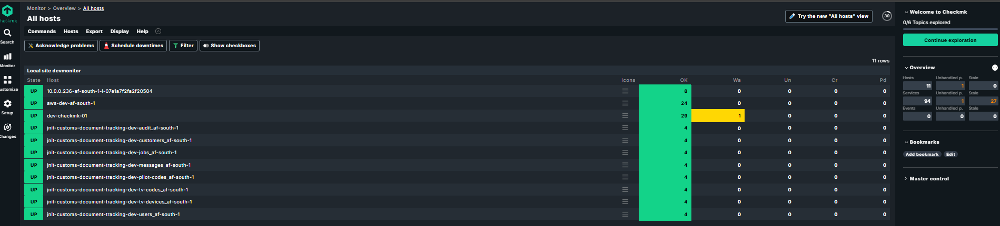
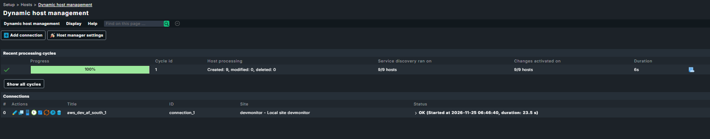
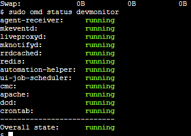
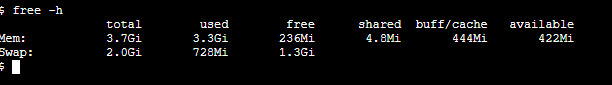
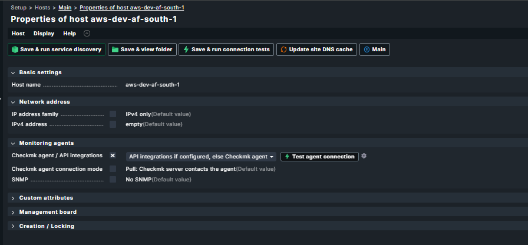

# Checkmk Installation and AWS Monitoring
Development account implementation record and operating guide

Prepared by Jacques O'Connell
25 November 2026

## 1. Purpose and final outcome
This document records the manual installation of Checkmk Ultimate on an Ubuntu EC2 instance in the AWS development account, configuration of monitoring for the server itself, and integration with AWS services used by the document workflow. It includes the reusable commands, console settings, errors and corrections, evidence, and limits of the demonstration. This lab is separate from StratHost and was not deployed using Terraform.

I installed and configured this lab manually using the AWS console, Session Manager, PowerShell and the Checkmk interface. I recorded the steps, commands and troubleshooting below for review and future reference. Where I did not retain output or perform a test, I state that limitation. The command record reconstructs the installation procedure; it is not a complete shell history export.

The final All hosts screenshot I captured shows all 11 configured hosts UP. There are 94 services: 93 OK and one warning, based on the row totals. No row shows CRITICAL, UNKNOWN or PENDING. The AWS account host has 24 OK services, the local Linux host has 29 OK services and one warning, the generated EC2 resource host has eight OK services, and eight document workflow resource hosts have four OK services each. The sidebar also reports 27 stale services. Therefore the screenshot establishes host recovery and reported service states, but does not establish that every service result was fresh.

The local host warning was previously identified as Memory. The final host overview does not display the warning service name, so that identity is not reconfirmed by the final image. Capacity remained constrained after AWS collection began. Notifications, restore testing and reboot persistence were not demonstrated.

At closure, I confirmed that my EBS snapshot had completed and planned to terminate the instance. I have not included the snapshot ID or a verified recovery test in this record. I have not documented a source-volume or encryption review, application-consistency test, or completed instance termination.

Identifiers and tokens in reusable text are placeholders. Passwords and one-time tokens are omitted. The screenshots I selected retain resource names and an EC2 identifier as implementation evidence; screenshots containing credentials or the account ID have been excluded from this delivery.

## 2. Environment and configuration record
| Item | Recorded value and evidence |
|---|---|
| AWS region | af-south-1, Africa Cape Town |
| Initial instance | I selected t3.small; approximately 1.9 GiB RAM observed |
| Subsequent instance | I selected the available c7i-flex.large option; approximately 3.7 GiB usable RAM observed; no separate instance-type query retained |
| Operating system | Ubuntu 24.04.5 LTS, Noble Numbat, x86_64 |
| Root filesystem | ext4, approximately 29 GiB; 23 GiB available before creating swap |
| Disk recommendation | 30 GiB gp3 with encryption; volume type and encryption were not inspected |
| Checkmk | Ultimate 2.5.0p21; commercial trial selected, expiry not inspected |
| Site and administrator | devmonitor; cmkadmin; I retained the password privately |
| Local monitoring host | dev-checkmk-01, address 127.0.0.1 |
| AWS collection host | aws-dev-af-south-1, final correction to No IP |
| Instance role and profile | dev-checkmk-ec2-role |
| Existing managed policy | AmazonSSMManagedInstanceCore, confirmed in IAM screenshot |
| Additional inline policy | CheckmkDevAccountMonitoring; I successfully created the corrected policy |
| Client tools | Windows AWS CLI 2.35.11; Session Manager plugin 1.2.896.0 |
| Dashboard access | SSM forwarding local TCP 8080 to instance TCP 80 |
| Apache process limit | Five; the UI rejected the proposed value of two |
| Swap | 2 GiB at /swapfile-checkmk; active in terminal evidence |
| Dynamic connection | ID connection_1; title aws_dev_af_south_1; site devmonitor |

The launch recommendations were the official Canonical Ubuntu 24.04 LTS AMD64 image, a monitoring name tag, IMDSv2 required, and a security group with no inbound rules for the chosen SSM access method. Exact AMI ID, trust policy, subnet routes, security group rules, IMDS settings, tags and disk encryption were not audited. Session Manager was the administration method actually used. A key pair is not required for that method; the launch key-pair selection was not recorded.

## 3. Prepare Ubuntu and verify the platform
Run Linux commands inside the EC2 Session Manager shell. The Windows commands in section 6 run on the laptop. Do not paste a shell prompt character with a command.

```bash
cat /etc/os-release
uname -m
free -h
df -h /
sudo apt update
sudo apt install -y curl ca-certificates gnupg
```

The observed platform was Ubuntu 24.04.5 LTS on x86_64. Initial RAM was approximately 1.9 GiB with no swap. A later disk check showed about 29 GiB total capacity. Package preparation completed with zero packages upgraded or newly installed and five not upgraded. A full operating system upgrade was suggested earlier, but its completion was not evidenced.

One terminal entry resulted in df reporting that sudo, apt and update were missing files. Those words had been interpreted as operands to an unfinished df command. Press Ctrl+C, wait for a fresh prompt and run one command at a time. This was an input problem, not proof that apt was absent.

## 4. Download verify and install Checkmk
I selected Ultimate for this trial installation after initially considering Community. The following package matches Ubuntu Noble and AMD64. These are the historical package coordinates I used in the lab, not a recommendation that this release will remain the latest for future installations. For a new installation, obtain a currently supported package from Checkmk and check the matching operating system and signing instructions.

```bash
cd /tmp
curl -fLO https://download.checkmk.com/checkmk/2.5.0p21/check-mk-ultimate-2.5.0p21_0.noble_amd64.deb
curl -fLO https://download.checkmk.com/checkmk/Check_MK-pubkey.gpg
gpg --import Check_MK-pubkey.gpg
gpg --verify check-mk-ultimate-2.5.0p21_0.noble_amd64.deb
sudo apt install -y /tmp/check-mk-ultimate-2.5.0p21_0.noble_amd64.deb
omd version
```

GPG reported a good signature. The recorded primary fingerprint was B1E7 1065 75B7 23F0 0611 C612 434D AC48 C450 3261. The warning about a key not being certified with a trusted signature describes the local trust database; it does not contradict the good cryptographic signature. Authenticity depends on checking the fingerprint against the publisher through a trusted source.

I verified the package installation with the output OMD Open Monitoring Distribution Version 2.5.0p21.ultimate. My original download text used wget with an escaped URL scheme; I switched to the curl command above. I did not retain evidence of a successful wget run.

## 5. Create the site and address initial freezing
```bash
sudo omd create devmonitor
sudo omd start devmonitor
sudo omd status devmonitor
curl -I http://localhost/devmonitor/
```

Site creation generated the cmkadmin password, which I retained privately. The first start appeared to freeze on the small instance, and I accidentally appended text to the terminal line. I considered memory pressure a plausible explanation, but did not prove an out-of-memory event. I changed to an available larger instance option after other sizes were greyed out. The console restricted the available instance choices; I did not establish the underlying account restriction or independently validate pricing eligibility.

I followed the resize workflow by stopping the EBS-backed instance in EC2, selecting the available compatible c7i-flex.large option, starting it and reconnecting through Session Manager. I retained the existing root disk and Checkmk site. The later memory output showed approximately 3.7 GiB total RAM. I could not resize further within the available account options.

The subsequent site status showed agent-receiver, mkeventd, liveproxyd, mknotifyd, rrdcached, redis, automation-helper, ui-job-scheduler, cmc, apache, cdc and crontab running, with Overall state running. The curl request returned HTTP 302 to /devmonitor/check_mk/, confirming that the local web application was responding.

## 6. Install the Windows plugin and access the dashboard
Check the laptop tools in Windows PowerShell:

```powershell
aws --version
session-manager-plugin --version
```

AWS CLI was already installed. My first Session Manager plugin command returned CommandNotFoundException. I installed the official Windows SessionManagerPluginSetup.exe and checked the plugin again; the resulting version was 1.2.896.0. For future reference, reopen PowerShell after installation if PATH has not refreshed. The following full-path command is an alternative; I did not retain separate output for that alternative:

```powershell
& "$env:ProgramFiles\Amazon\SessionManagerPlugin\bin\session-manager-plugin.exe" --version
```

Verify the active AWS identity. The lab returned an IAM-user identity in the development account. Do not include access keys or the full identity output in a shared report.

```powershell
aws sts get-caller-identity --region af-south-1
aws ssm start-session --region af-south-1 --target INSTANCE_ID --document-name AWS-StartPortForwardingSession --parameters "portNumber=80,localPortNumber=8080"
```

Replace INSTANCE_ID with the current running instance identifier. The initial tunnel command omitted its closing quote after 8080. PowerShell displayed the continuation prompt >>. Press Ctrl+C and rerun the complete one-line command. The successful attempt reported Port 8080 opened and Waiting for connections.

Leave that PowerShell window open, browse to http://localhost:8080/devmonitor/ and log in as cmkadmin with the generated password. For future access, run the tunnel again if the earlier session has closed. SSM needs a running managed instance, the instance role, working SSM connectivity and an authorised client identity. The local tunnel does not require public inbound SSH or dashboard access. If the instance is terminated, this command cannot reconnect to the old instance; recovery or a new deployment is required first.

Installer: https://s3.amazonaws.com/session-manager-downloads/plugin/latest/windows/SessionManagerPluginSetup.exe

## 7. Configure monitoring of the Checkmk server
In Setup, Hosts, Main, add host dev-checkmk-01. Use IPv4 address 127.0.0.1, Checkmk agent and API integrations set to API integrations if configured else Checkmk agent, Pull mode, and No SNMP. The Main folder is already a valid destination. A linux folder was created during navigation but remained empty.

Testing the agent initially returned Connection refused because the agent was not yet installed. The Checkmk server package and the Linux monitoring agent are separate components. In the host wizard, choose Download Checkmk agent, Linux, DEB, then generate a one-time token. Use the command generated by the installed version. The historical request shape was:

```bash
cd "$(mktemp -d)"
curl -o check-mk-agent_2.5.0p21-1_all.deb -fJG \
  'http://localhost/devmonitor/check_mk/api/internal/domain-types/agent/actions/download_by_host_via_token/invoke' \
  --header 'Accept: application/octet-stream' \
  --header 'Authorization: CMK-TOKEN DOWNLOAD_TOKEN' \
  --data-urlencode 'os_type=linux_deb' \
  --data-urlencode 'agent_type=host_name' \
  --data-urlencode 'host_name=dev-checkmk-01' &&
sudo dpkg -i check-mk-agent_2.5.0p21-1_all.deb
```

DOWNLOAD_TOKEN is a placeholder for a newly generated token, including the exact token format shown by the wizard. Never reuse a token from a screenshot. The internal API path is version-specific; the wizard remains the source for a future installation. The localhost URL here is evaluated on the EC2 server, whereas localhost:8080 is the laptop browser tunnel.

The first download failed with curl error 23 and Permission denied while opening the destination file. Move to a new writable directory using mktemp as above. The next token attempt was reported expired. A one-time token may have been consumed by the initial request despite the failed local file write; actual expiry was not proven. Generating a fresh token and repeating the download worked.

The installation warning that the controller was operating in insecure mode was addressed by registering it. Generate the registration token in the wizard, then use:

```bash
sudo cmk-agent-ctl register \
  --hostname dev-checkmk-01 \
  --server localhost \
  --site devmonitor \
  --ott REGISTRATION_TOKEN
sudo cmk-agent-ctl status
```

My initial registration command used --server localhost:80. That was incorrect for this registration flow and returned InvalidContentType because the receiver protocol reached the web port. I corrected it to --server localhost so the controller could discover the Agent Receiver, normally on port 8000. Registration completed and the connection test succeeded; I subsequently confirmed working local services in Checkmk. I did not retain the standalone controller status output.

Return to service discovery. The initial page showed No cached data available and requested a rescan. Rescan succeeded after the registered agent had data available. Accept the discovered services and labels, then activate the changes. An event-history warning had listed 27 unmonitored services and eight new labels before acceptance. The later dashboard showed one host UP and 30 services, with 29 OK and one Memory warning.

## 8. Reduce memory pressure within the fixed instance size
Inspect memory and the largest processes:

```bash
free -h
ps -eo pid,comm,rss --sort=-rss | head -n 15
```

The initial warning reported 85.11 percent used, 3.17 GiB of 3.72 GiB. Committed memory was 137.49 percent, 5.12 GiB against 3.72 GiB without swap. Committed allocations are not the same as resident physical RAM. Large processes included the UI scheduler, Apache workers, automation helpers and Python processes.

In Setup, General, Global settings, Site management, Apache process tuning, the factory process limit was 64. This is a limit, not evidence that 64 Apache processes were running. I tried setting the value to two, but the installed UI rejected it. I set five, saved and activated the setting, then restarted only the site Apache process:

```bash
sudo -iu devmonitor omd restart apache
free -h
```

After restart, available memory improved to approximately 918 MiB. A subsequent service view showed 70.03 percent used, 2.61 GiB of 3.72 GiB, but committed memory still warned at 121.43 percent. Thresholds were not raised to hide the warning.

Verify the root filesystem and absence of an existing swap file before the one-time creation commands:

```bash
df -hT /
sudo swapon --show
ls -lh /swapfile /swapfile-checkmk 2>/dev/null
sudo fallocate -l 2G /swapfile-checkmk
sudo chmod 600 /swapfile-checkmk
sudo mkswap /swapfile-checkmk
sudo swapon /swapfile-checkmk
sudo swapon --show
free -h
```

These are historical creation steps, not commands to rerun over an existing active swap file. The evidence showed ext4, 23 GiB free before creation and no existing swap. Activation succeeded with a 2 GiB file. Persist the entry:

```bash
sudo cp --update=none /etc/fstab /etc/fstab.before-checkmk-swap
grep -q '^/swapfile-checkmk[[:space:]]' /etc/fstab || printf '%s\n' '/swapfile-checkmk none swap sw,nofail 0 0' | sudo tee -a /etc/fstab
sudo systemctl daemon-reload
grep '^/swapfile-checkmk[[:space:]]' /etc/fstab
```

My original backup command used cp -n. Ubuntu warned that its behaviour was non-portable and suggested --update=none. I used the corrected command, which preserves an existing backup, and completed the persistence steps. I did not perform a reboot test.

After AWS discovery, the last terminal snapshot showed 3.7 GiB physical RAM, 3.3 GiB used, 422 MiB available and 728 MiB of the 2 GiB swap used. Swap provided additional virtual-memory backing, but did not establish sufficient physical capacity. The follow-up diagnostic vmstat 1 10 was suggested, not run. Continuous paging, a memory leak or an out-of-memory event was not proven.

## 9. Attach monitoring permissions to the instance role
I confirmed dev-checkmk-ec2-role and its instance profile in IAM, with AmazonSSMManagedInstanceCore attached. I kept that policy for Session Manager and added the custom inline policy CheckmkDevAccountMonitoring to the existing role. I successfully created the corrected policy and then obtained AWS monitoring data. I did not retain a separate API readback of the final policy attachment.

The policy template is included with this guide and reproduced in Appendix A. Before submitting it to IAM, replace every DEV_ACCOUNT_ID placeholder with the actual twelve-digit development account ID. The template is deliberately not directly deployable. Retain the legal ${aws:PrincipalAccount} variable in the S3 Condition. In IAM, open the role, Add permissions, Create inline policy, JSON, replace the editor contents with the rendered policy, review and create under the recorded name.

The first policy failed with The policy failed legacy parsing. It contained ${aws:PrincipalAccount} in the account segment of resource ARNs. IAM does not permit policy variables in that ARN segment. A local JSON syntax check had not detected this IAM semantic error. I corrected the resource ARNs to use explicit account IDs. I could not open the temporary rendered-policy file link, so I copied the complete corrected JSON directly into the IAM editor. Policy creation then succeeded.

The policy grants regional inventory and metrics reads for the selected services, with af-south-1 conditions where applicable. S3 bucket enumeration is account-global, and own-bucket location and tag metadata can be read across regions so the collector can identify and filter buckets. It does not grant S3 object reads or DynamoDB item reads.

Lambda monitoring required a refinement to the initial metadata-only expectation. The classic collector uses Lambda REPORT logs for memory and cold-start metrics. The policy permits log reads and Insights queries in the account's af-south-1 /aws/lambda/* log groups. The collector filters for REPORT records, but IAM does not restrict these permissions to those records; other log content in that scope can be read. Insights queries can incur charges. StopQuery uses a wildcard resource with a regional condition. No static AWS keys were created for this integration, and workload mutation, invocation, Secrets Manager value access and KMS Decrypt were not granted by this policy.

## 10. Configure the AWS integration
Quick Setup requested static access keys. Use the advanced rule under Setup, Agents, VM cloud container, Amazon Web Services AWS instead. The installed choices included Access key, Access key plus IAM role, IAM role on EC2 only, and None on EC2 only. Select None on EC2 instance only to use the default SDK credential chain and attached instance-profile credentials. None does not mean unsigned requests. The separate IAM role option is an assume-role workflow and was not required here.

Create the account host aws-dev-af-south-1 in Main, with No IP, API integrations if configured else Checkmk agent, and No SNMP. The final No IP correction is documented in section 12. Scope the advanced AWS rule to this explicit host, not dev-checkmk-01.

| AWS rule setting | Intended configuration |
|---|---|
| Authentication | None on EC2 instance only |
| Region | af-south-1 only |
| Selected services | EC2, EBS, S3, Lambda, DynamoDB, RDS, SNS, CloudWatch alarms |
| ECS | I left ECS disabled |
| Global integrations | Cost Explorer, Route 53 and CloudFront were excluded from my intended scope; no final rule screenshot retained |
| Service limit monitoring | Disabled; quota permissions were not included |
| Explicit host match | aws-dev-af-south-1 |

I selected the eight listed services and af-south-1 as the only region. Selecting an integration does not establish that the account contains resources of every selected service. During editing, the form still showed Access key with an empty secret. I switched to the role-based None option to remove that requirement. I also encountered and resolved An empty value is not allowed here. I did not record which field caused that generic validation message.

I saved and activated the AWS configuration, ran discovery for the account host, accepted the discovered services and labels, and activated the changes. My first AWS discovery succeeded. The final evidence shows 24 account-host services OK, although the stale-service count on the overview qualifies data freshness.

## 11. Create resource hosts from AWS piggyback data
In Setup, Hosts, Dynamic host management, add a connection using Piggyback data. Piggyback places resource-specific results on separate hosts while the AWS account host runs the collector.

| Connection property | Recorded setting and verification |
|---|---|
| Actual saved ID | connection_1 |
| Actual saved title | aws_dev_af_south_1 |
| Site | devmonitor |
| Source restriction | I intended ^aws-dev-af-south-1$; no final setting screenshot retained |
| Sync interval | I intended two minutes; the pre-save screenshot showed one minute. I did not retain a final interval screenshot |
| Creation folder | Main |
| SNMP | No SNMP |
| Agent and API integrations | No API integrations no Checkmk agent |
| Piggyback | Always use and expect piggyback data |
| IP address family | No IP |
| Service discovery | Discover services during creation enabled |
| Automatic deletion | Disabled |

The initial suggested ID and title differed from those actually saved. The observed connection_1 and aws_dev_af_south_1 are the authoritative names; no recreation was required. I have distinguished my intended source restriction and interval from the settings captured after saving.

The completed first cycle directly showed 100 percent progress, nine created hosts, zero modified and zero deleted, discovery on nine of nine hosts and activation on nine of nine hosts. The cycle displayed six seconds, and the connection status was OK with a displayed duration of 23.5 seconds. A later screenshot showed another Running cycle waiting for its next batch; this alone was not an error.

The final inventory contains the two manual hosts plus nine generated hosts. Eight generated names correspond to document workflow resources ending audit, customers, jobs, messages, pilot-codes, tv-codes, tv-devices and users. The ninth is the EC2 resource host. Names and metrics alone are not an end-to-end test of document processing or a proof of complete AWS inventory coverage.

## 12. Correct the AWS account host state
The later dashboard showed ten UP hosts and one DOWN host, with 94 services. The AWS account host detail showed all 24 services OK but a host summary Failed to lookup IP address and no explicit IP address configured. Its properties screenshot confirmed inherited IPv4 only with an empty address. I had intended to use No IP, but had not explicitly selected it.

The correction was entirely in the Checkmk UI:

1. Open Setup, Hosts, Main and edit aws-dev-af-south-1.
2. Tick the checkbox beside IP address family to override inheritance.
3. Select No IP instead of IPv4 only.
4. Keep API integrations if configured else Checkmk agent.
5. Save and view folder, then activate pending changes.
6. Allow the next monitoring check to update the host state.

The final All hosts screenshot shows aws-dev-af-south-1 UP and all 11 hosts UP, confirming the correction's observed result. Do not assign a fabricated IP address or open network ingress to resolve an API-only host check. The final screenshot still shows one service warning and 27 stale services in the sidebar; freshness was not investigated before closure.

## 13. Troubleshooting reference
| Symptom | Cause or evidence | Correction and observed result |
|---|---|---|
| df treats sudo apt update as filenames | Incomplete terminal input was the likely cause | Ctrl+C then individual commands; preparation completed |
| Initial start appears frozen | Small RAM; exact root cause unproven | Reconnect and resize; later site fully running |
| GPG trust warning | Imported key lacks local trust certification | Check publisher fingerprint; good signature observed |
| Plugin command not found | Plugin initially absent or PATH stale | Install official plugin and reopen PowerShell; version reported |
| PowerShell continuation prompt | Missing closing double quote | Ctrl+C then complete one-line tunnel command; tunnel opened |
| Agent connection refused | Agent not installed yet | Install and register agent; discovery subsequently worked |
| curl error 23 | Destination file permission denied | Writable mktemp directory and fresh token; installation worked |
| Token reported expired | Actual expiry versus one-time use not proven | Generate a new token for the retry |
| InvalidContentType registration error | My initial command used localhost port 80 | Use --server localhost; registration completed |
| No cached agent data | Initial cache not yet available | Rescan after registration; services discovered |
| Discovery warning | Services and labels not yet accepted | Accept services and labels then activate |
| Memory warning | Resident and committed pressure | Apache limit five and 2 GiB swap; capacity remained limited |
| Apache value two rejected | Installed UI validation | Use five, save and restart site Apache |
| cp -n warning | Portability behaviour warning | Use --update=none; I completed the persistence steps |
| AWS form requires keys | Wrong wizard or Access key selection | Advanced AWS rule and None on EC2 only |
| Generic empty field error | I did not record the specific field | I corrected the form and saved it successfully |
| IAM legacy parsing failure | Variable in ARN account segment | I used explicit account IDs; IAM accepted the policy |
| Corrected file inaccessible | Temporary link delivery failed | Full rendered JSON delivered inline |
| Dynamic connection Running | Processing or waiting for a cycle | Let cycle finish; nine hosts created and connection OK |
| AWS account host DOWN | Inherited IPv4 with no address | Explicit No IP and activation; final host UP |
| 27 stale services in final overview | Freshness issue visible, cause unexamined | Record as unresolved; state colours alone do not prove freshness |

## 14. Closure snapshot and recovery record
I created an EBS snapshot and confirmed its status was Completed before my planned EC2 termination. This document does not include a recorded source-volume review or a completed termination result. I did not use a destruction command in the documented procedure.

Before manual termination, confirm the completed snapshot covers the root EBS volume containing /opt/omd and the operating system, and record its snapshot ID, region, source volume, date and encryption key if applicable. If there were separate application or site-data volumes, those require their own recovery coverage. This lab did not verify any additional disks.

An EBS snapshot preserves disk blocks, not an independently proven application backup or a complete EC2 launch specification. AWS recommends pausing writes and stopping an instance before snapshotting its root volume. Whether that was done here is unknown. A completed snapshot is ready for use, but successful Checkmk recovery still requires a restore test. Preserve the role and settings record if rebuilding; a snapshot does not recreate the role, network, instance profile or client authorisation.

For a future recovery, use AWS's supported root-volume or image restoration process, restore appropriate encrypted-volume access, reattach the intended instance profile, confirm networking and SSM, verify the site and agent registration, and update the tunnel target to the new instance. These are future recovery activities, not tests completed in this lab. Retained snapshots and any retained volumes may continue to incur storage charges.

The demonstration did not include notification delivery, independent monitoring of this monitoring server, a site backup and restore, reboot persistence validation, sustained-load testing, paging-rate diagnostics, service-freshness remediation or complete validation of every selected AWS integration. No claim of production readiness is made.

## Appendix A Monitoring IAM policy
This exact shareable template accompanies the document. Replace DEV_ACCOUNT_ID before submitting to IAM; keep the S3 Condition variable unchanged. The policy is the corrected lab design, not a guarantee of every API path or future connector release. Review actual AccessDenied messages before adjusting scope.

```json
{
  "Version": "2012-10-17",
  "Statement": [
    {
      "Sid": "RegionalInventoryAndMetrics",
      "Effect": "Allow",
      "Action": [
        "ec2:DescribeInstances",
        "ec2:DescribeInstanceStatus",
        "ec2:DescribeSecurityGroups",
        "ec2:DescribeVolumes",
        "ec2:DescribeVolumeStatus",
        "cloudwatch:GetMetricData",
        "cloudwatch:GetMetricStatistics",
        "cloudwatch:ListMetrics",
        "cloudwatch:DescribeAlarms",
        "dynamodb:ListTables",
        "lambda:ListFunctions",
        "rds:DescribeDBInstances",
        "sns:ListTopics",
        "tag:GetResources",
        "logs:DescribeLogGroups"
      ],
      "Resource": "*",
      "Condition": {
        "StringEquals": {
          "aws:RequestedRegion": "af-south-1"
        }
      }
    },
    {
      "Sid": "SameAccountRegionalResourceMetadata",
      "Effect": "Allow",
      "Action": [
        "dynamodb:DescribeTable",
        "dynamodb:ListTagsOfResource",
        "lambda:ListTags",
        "lambda:ListProvisionedConcurrencyConfigs",
        "rds:ListTagsForResource",
        "sns:GetTopicAttributes",
        "sns:ListTagsForResource"
      ],
      "Resource": [
        "arn:aws:dynamodb:af-south-1:DEV_ACCOUNT_ID:table/*",
        "arn:aws:lambda:af-south-1:DEV_ACCOUNT_ID:function:*",
        "arn:aws:rds:af-south-1:DEV_ACCOUNT_ID:db:*",
        "arn:aws:sns:af-south-1:DEV_ACCOUNT_ID:*"
      ],
      "Condition": {
        "StringEquals": {
          "aws:RequestedRegion": "af-south-1"
        }
      }
    },
    {
      "Sid": "DiscoverOwnS3Buckets",
      "Effect": "Allow",
      "Action": "s3:ListAllMyBuckets",
      "Resource": "*"
    },
    {
      "Sid": "OwnBucketLocationAndTagsOnly",
      "Effect": "Allow",
      "Action": [
        "s3:GetBucketLocation",
        "s3:GetBucketTagging"
      ],
      "Resource": "arn:aws:s3:::*",
      "Condition": {
        "StringEquals": {
          "aws:ResourceAccount": "${aws:PrincipalAccount}"
        }
      }
    },
    {
      "Sid": "LambdaReportLogMetrics",
      "Effect": "Allow",
      "Action": [
        "logs:FilterLogEvents",
        "logs:StartQuery",
        "logs:GetQueryResults"
      ],
      "Resource": "arn:aws:logs:af-south-1:DEV_ACCOUNT_ID:log-group:/aws/lambda/*",
      "Condition": {
        "StringEquals": {
          "aws:RequestedRegion": "af-south-1"
        }
      }
    },
    {
      "Sid": "CancelTimedOutRegionalLogQueries",
      "Effect": "Allow",
      "Action": "logs:StopQuery",
      "Resource": "*",
      "Condition": {
        "StringEquals": {
          "aws:RequestedRegion": "af-south-1"
        }
      }
    }
  ]
}
```

## Appendix B Additional historical commands and input corrections
I retained these additional commands as alternatives, diagnostics or erroneous examples. They are retained for completeness and are not additional completed work.

```bash
# Suggested OS upgrade only; completion not evidenced
sudo apt upgrade -y
# Suggested site listing during recovery; output not retained
sudo omd sites
# Suggested paging diagnostic only; not run
vmstat 1 10
# Historical backup command that produced a warning; superseded
sudo cp -n /etc/fstab /etc/fstab.before-checkmk-swap
```

Historical registration error, do not reuse the port:

```bash
sudo cmk-agent-ctl register --hostname dev-checkmk-01 --server localhost:80 --site devmonitor --ott REGISTRATION_TOKEN
```

My original wget text began wget https\://download.checkmk.com/checkmk/2.5.0p21/check-mk-ultimate-2.5.0p21_0.noble_amd64.deb. I switched to curl and did not record a successful wget execution. My incomplete PowerShell tunnel command ended with an unclosed quote after localPortNumber=8080; use the corrected full command in section 6. I used Ctrl+C to cancel incomplete shell input. Do not paste the displayed $ or PS prompt, or the >> continuation markers, into a new command.

## Appendix C Official references
These links provide vendor procedures and parameter semantics. The installed version and screenshots I captured are the evidence for what happened in the lab. Latest documentation can change after the recorded date.

1. Checkmk Debian and Ubuntu installation https://docs.checkmk.com/latest/en/install_packages_debian.html
2. Checkmk site administration https://docs.checkmk.com/latest/en/omd_basics.html
3. Checkmk initial monitoring https://docs.checkmk.com/latest/en/intro_setup_monitor.html
4. Checkmk Linux agent https://docs.checkmk.com/latest/en/agent_linux.html
5. Checkmk self monitoring https://docs.checkmk.com/latest/en/self_monitoring.html
6. Checkmk processes https://docs.checkmk.com/latest/en/cmk_processes.html
7. Checkmk AWS integration https://docs.checkmk.com/latest/en/monitoring_aws.html
8. Checkmk dynamic host management https://docs.checkmk.com/latest/en/dcd.html
9. Checkmk host checks https://docs.checkmk.com/latest/en/host_checks.html
10. Checkmk licensing https://docs.checkmk.com/latest/en/license.html
11. AWS Windows Session Manager plugin https://docs.aws.amazon.com/systems-manager/latest/userguide/install-plugin-windows.html
12. AWS Session Manager and port forwarding https://docs.aws.amazon.com/systems-manager/latest/userguide/session-manager-working-with-sessions-start.html
13. AWS changing instance type https://docs.aws.amazon.com/AWSEC2/latest/UserGuide/change-instance-type-of-ebs-backed-instance.html
14. IAM policy variable placement https://docs.aws.amazon.com/IAM/latest/UserGuide/reference_policies_variables.html
15. CloudWatch Logs IAM actions https://docs.aws.amazon.com/service-authorization/latest/reference/list_logs.html
16. Ubuntu swapon manual https://manpages.ubuntu.com/manpages/noble/man8/swapon.8.html
17. EBS snapshot states https://docs.aws.amazon.com/ebs/latest/userguide/ebs-describing-snapshots.html
18. EBS snapshot consistency https://docs.aws.amazon.com/ebs/latest/userguide/ebs-creating-snapshot.html
19. EBS volume deletion on termination https://docs.aws.amazon.com/AWSEC2/latest/UserGuide/preserving-volumes-on-termination.html

## Appendix D Captured screenshot evidence

I captured these screenshots during setup and verification. They show earlier warnings and the final recovery at their capture times.

### Figure 1 Final host overview



All 11 hosts UP. Row totals show 94 services with one warning. The sidebar reports 27 stale services, so freshness remains a qualification.

### Figure 2 Completed dynamic host cycle



Nine hosts created, discovery and activation completed for nine of nine, and connection status OK.

### Figure 3 Running Checkmk site



All listed OMD components running at the time of the status command.

### Figure 4 Last recorded memory snapshot



3.3 GiB RAM used, 422 MiB available, and 728 MiB of 2 GiB swap used. This does not prove sustained paging.

### Figure 5 AWS host configuration before correction



My properties screenshot shows inherited IPv4 only. Section 12 records the explicit No IP correction, with recovery evidenced by my final overview.
